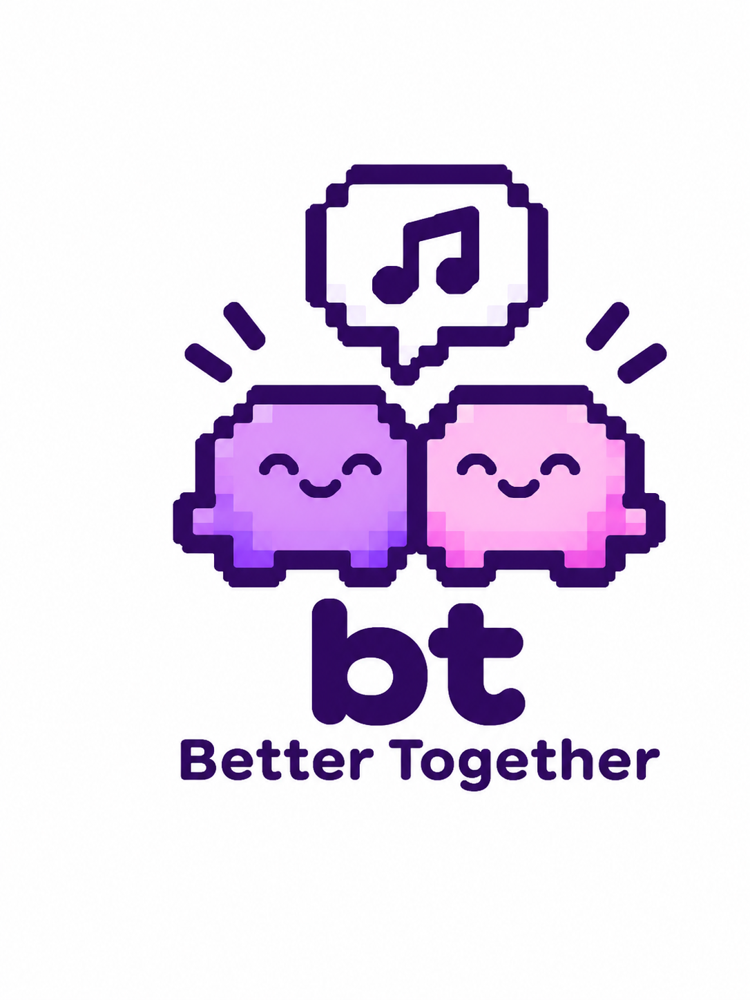

<p align="center">
  
</p>

# In sync. 🎧

Some songs sound better together.

This project started with a simple idea: distance shouldn’t stop us from listening to music together. An app that lets two people share the same music, in real time, wherever they are.

Discover new songs, send a track that says it all, or simply keep each other company without having to fill the silence.

---

### 🎶 The idea

A shared space where listening to music becomes something you do together. You bring your person; the music does the rest.

### 🚧 Work in progress

We’re building the experience, one song at a time. The goal: less friction, more shared moments.

---

## 🛠️ Running it

bt is an internet radio: the server downloads each song's audio with `yt-dlp`, plays the shared queue itself and broadcasts one MP3 stream that every listener's browser plays ([why](docs/adr/0001-server-side-radio.md)).

> Extracting audio with yt-dlp goes against YouTube's Terms of Service. This is for private use, at your own risk. Keep yt-dlp up to date (`yt-dlp -U`).

### Requirements

- [rustup](https://rustup.rs) (the toolchain in `rust-toolchain.toml` installs itself)
- `ffmpeg`
- [`yt-dlp`](https://github.com/yt-dlp/yt-dlp#installation) (the standalone release build) and [`deno`](https://deno.com) (yt-dlp needs a JS runtime for YouTube)
- For `make check`: `shellcheck` and [`actionlint`](https://github.com/rhysd/actionlint)

### Develop

```sh
make run    # then open http://localhost:3000 and press "Connect audio"
make check  # fmt, clippy, tests, shellcheck, actionlint (what CI runs)
```

The tests use real ffmpeg and a fake yt-dlp (`tests/fake-yt-dlp.sh`), so they don't need network access.

### Configuration

All environment variables are optional.

| Var | Default | Meaning |
|---|---|---|
| `BT_ADDR` | `127.0.0.1:3000` | Address the app listens on |
| `BT_CACHE_DIR` | `./cache` | Downloaded audio |
| `BT_FFMPEG` | `ffmpeg` (from `PATH`) | ffmpeg binary |
| `BT_YTDLP` | `yt-dlp` (from `PATH`) | yt-dlp binary |

### Download a release

The [latest release](https://github.com/lulivi/bt/releases/latest) has static Linux binaries for `x86_64` and `aarch64`. They need `ffmpeg`, `yt-dlp` and `deno` in `PATH` (see [Requirements](#requirements)).

```sh
target=x86_64-unknown-linux-musl   # or aarch64-unknown-linux-musl
url=https://github.com/lulivi/bt/releases/latest/download
curl -fLO "$url/bt-$target.tar.gz" -fLO "$url/bt-$target.tar.gz.sha256"
sha256sum -c "bt-$target.tar.gz.sha256"
tar -xzf "bt-$target.tar.gz" bt
./bt   # then open http://localhost:3000 and press "Connect audio"
```

### Deploy

`make deploy` cross-compiles a static binary and installs it on any Linux host over SSH as a systemd **user** service (`deploy/bt.service`).

On the host, once:
- put `ffmpeg`, `yt-dlp` and `deno` in `PATH` (`~/.local/bin` works);
- run `loginctl enable-linger <user>` so the service runs without an open session.

Then, from your machine:

```sh
make deploy DEPLOY_HOST=<ssh host>   # DEPLOY_TARGET=x86_64-unknown-linux-musl for x86_64 hosts
make logs DEPLOY_HOST=<ssh host>
```

The service runs from `~/.local/share/bt` (so audio is cached in `~/.local/share/bt/cache`). Set `BT_*` variables with `systemctl --user edit bt`. If listeners connect from outside your network, put a reverse proxy with HTTPS in front of `BT_ADDR`.
